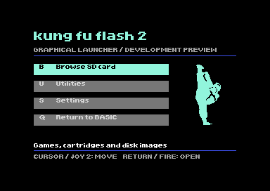

# KFF2 Graphical Menu

An experimental graphical menu for Kung Fu Flash 2, inspired by EasyFlash 3.

The current milestone is a standalone C64 PRG for testing the interface in VICE.
It has not yet been integrated into the KFF2 firmware.

## Try the preview

Download [kff2-menu-preview.prg](preview/kff2-menu-preview.prg), then autostart it
in VICE's C64 emulator (`x64sc`). No KFF2 emulation is required.

- Cursor keys move the highlight. Return selects.
- B opens the sample browser. F2 or Run/Stop returns home.
- U and S show Utilities and Settings placeholders.
- Q returns to BASIC.
- Joystick support uses port 2, but physical joystick input remains untested.

The sample browser does not access an SD card or load games. This repository
does not contain flashable firmware, C64 ROMs or games.

## Build

Install cc65, GNU make and sed, then run:

    make -C launcher/preview

The compiled program is `launcher/build/preview/kff2-menu-preview.prg`.
Regenerate the one-bit kicking icon with:

    python3 tools/make_kicker.py

A prebuilt copy, screenshot and source archive are under `preview/`.

## Current state

- Hires bitmap home screen with the EF3 proportional font.
- Cyan selection panels, contextual hints and keyboard shortcuts.
- Upright kicking silhouette based on the supplied visual reference.
- Working keyboard navigation, selection wraparound and exit to BASIC.
- VICE checks for PAL/NTSC startup and normal display restoration.

The detailed memory map, test notes and integration plan are in
[launcher/preview/README.md](launcher/preview/README.md).

## ROM-space findings

The stock launcher has 1,206 bytes free. Adding the current UI directly exceeds
its allocation by 3,227 bytes. A separate 4,062-byte UI payload links
successfully and could use the existing blank 16 KB region in the update.
The transfer and startup integration are still to be implemented.

See the [ROM-space investigation](docs/rom-space-investigation.md) and
[reproduction script](tools/investigate_rom.py) for measured results and the
comparison with EasyFlash 3.

## Next steps

1. Implement the flash-to-RAM UI transfer described in the ROM investigation.
2. Connect the graphical browser to real KFF2 directory data.
3. Test loading, utilities and settings on physical KFF2 hardware.
4. Consider favourites and additional features after the browser works.

## Upstream and credits

This repository contains the new UI and the KFF2 input code needed to build the
standalone preview. The complete upstream firmware and EF3 toolsets remain in
their respective repositories:

- [Kung Fu Flash 2](https://codeberg.org/KimJorgensen/KungFuFlash2),
  Kim Jørgensen, baseline commit `9c84d99` (one commit after v2.07).
- [EasyFlash 3 menu](https://github.com/easyflash-mirror/easyflash3-bootimage),
  Thomas Giesel, baseline commit `bf89562`. Supplies the proportional bitmap
  font and text renderer used here.

Original licence notices are retained. See [LICENSE](LICENSE) and
[EF3-LICENSE.md](launcher/ui/EF3-LICENSE.md). This is an altered development
version, not an official KFF2 or EasyFlash release.
