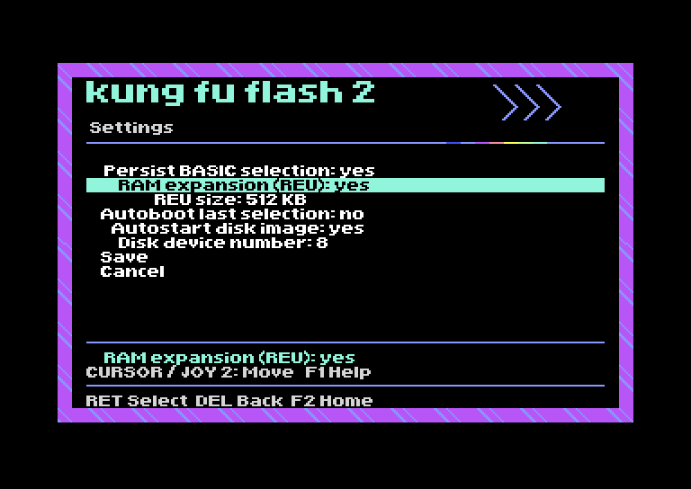

# KFF2 Graphical Menu

A graphical Home screen and shared menu style for **Kung Fu Flash 2**, inspired
by EasyFlash 3. The current experimental build is **G7.0.2**.

**[Download G7.0.2 firmware](https://github.com/Soopahfly/kff2-graphical-menu/raw/refs/heads/main/firmware/experimental/KungFuFlash_v2.G7.0.2.upd)** ·
[Installation and SD setup](docs/getting-started.md) ·
[Recovery](firmware/experimental/RECOVERY.md) ·
[Hardware test checklist](docs/testing.md) ·
[Roadmap](ROADMAP.md)

G7 is based on official **v2.07 plus one documentation commit**, `9c84d99`.
`2.G7` is this project's internal version label, not an official upstream release.
**G7.0.2 fixes the Copy to Favourites return path, returning to Home after
acknowledgement.** G7.0.1 fixed only the initial wait and is superseded.
Its internal cartridge label remains `2.G7`; identify the hotfix by its filename and
[checksum](firmware/experimental/SHA256SUMS). It contains no G8 features.
Software checks pass. On real hardware, the project owner reports working G7
PRG/CRT loading, saved REU-size/autoboot preferences and return to Home after reset
with autoboot disabled. The original G7 copy-result screen was reported to freeze. G7.0.2 fixes that
handshake in software; hardware confirmation and actual REU operation still need
verification. See [the dated hardware results](firmware/experimental/HARDWARE-TESTS.md).
Earlier G5 Home/SD-browser rendering was photographed on an LCD.

## Features

- **Games, Tools, Utilities and Favourites** shortcuts to ordinary SD folders.
- The same patterned border, masthead and proportional font across browsing,
  Settings/REU, file options, Help, search, messages and text reading.
- **F4 Random** immediately launches a supported file under `/Games`, avoiding
  the last ten distinct Games paths where possible.
- Persistent manual/random launch counts in `/.KFF2-history`, with a PC exporter.
- **Copy to Favourites** from Shift+Return file/folder options. Originals remain;
  existing destination files/folders are not overwritten.
- **REU size:** 256 KB, 512 KB or 1 MB, alongside the existing enable control.
- **Autoboot last selection:** choose whether startup returns to Home.

Existing cards retain **1 MB REU capacity and autoboot enabled**. Change a setting
and select **Save** to store it. The original 1,024-byte configuration layout is
preserved. [G7 operation, defaults and copy limits](docs/g7-features.md)

## SD card and controls

Use a **FAT32** card with `/Games`, `/Tools`, `/Utilities` and `/Favourites`.
Names are case-insensitive. Missing folders warn and fall back to SD root.
No menu PRG, artwork pack or font files are required on the card.

| Action | Control |
| --- | --- |
| Move / open | Cursor keys and Return, or joystick port 2 and Fire |
| Browse SD from Home | B |
| Settings from Home / browser | S / F5 |
| Built-in cart utilities | F3 |
| File/folder options, including Copy to Favourites | Shift+Return or held Fire |
| Go up in browser | DEL or Fire+left |
| Return Home from browser | F2 |
| Random game from Home or browser | F4 |
| BASIC from Home | Q |

The Utilities card opens `/Utilities`; F3 opens the built-in cartridge functions.
For multi-file games, copy the whole game folder to Favourites. Keep related
files and multiple disks together. [Full setup guide](docs/getting-started.md)

## Limits and test status

- G7 has limited positive hardware reports, not full compatibility validation.
  Favourites copying and REU operation at each capacity remain unverified.
  VICE fixtures simulate cartridge packets; they do not emulate the STM32 or REU bus timing.
- Physical CRT readability remains untested. LCD photos of G5 confirm only the
  Home and folder-browser presentation.
- Early startup diagnostics retain native text until graphics are available.
- exFAT, simultaneous CRT+REU, REU image loading/saving and expanded cartridge
  formats are not added in G7.
- Random chooses files, not recognised game titles or complete multi-disk sets.
  On-cart statistics and automatic history compaction are not implemented.

The C64 launcher remains **16 KB, with 630 bytes free** in its main allocation.
The update is **128 KB** and the reserved 16 KB flash region stays blank.
See the [build report](firmware/experimental/build-report.json) and
[SHA-256 checksums](firmware/experimental/SHA256SUMS).

## Documentation

| Topic | Guide |
| --- | --- |
| Install, SD folders, controls, REU and sorting | [Getting started](docs/getting-started.md) |
| G7 copying, settings and downgrade compatibility | [G7 features](docs/g7-features.md) |
| Physical testing and known evidence | [Testing](docs/testing.md) |
| USB DFU / SWD recovery | [Recovery](firmware/experimental/RECOVERY.md) |
| Shared appearance and browser implementation | [Shared UI](docs/uniform-ui.md), [browser](docs/browser.md) |
| Random selection and bookkeeping | [Random](docs/random-game.md), [launch history](docs/launch-history.md) |
| PC SD collection tools | [Copy planner](docs/copy-games.md), [hash catalogue](docs/hash-catalogue.md) |
| Build requirements and commands | [Building](docs/building.md) |
| Proposed features and acceptance checks | [Roadmap](ROADMAP.md) |
| Next milestone boundaries and work breakdown | [G8 scope](docs/g8-scope.md) |
| Earlier prototypes and ROM measurements | [Development history](docs/development-history.md) |

## VICE preview

Autostart [kff2-integration-test.prg](preview/kff2-integration-test.prg) in VICE
x64sc. B opens simulated entries, F2 returns Home, G/T/U/F choose collections,
S/F3 open simulated menus and Q returns to BASIC. F4 records the request and stops
before loading. This preview does not read your PC's SD card or execute games.
Its Settings/utilities lists are stand-ins, not the complete ARM implementation.

## Upstream and credits

This repository contains the UI, build tools and patches. Builds use:

- [Kung Fu Flash 2](https://codeberg.org/KimJorgensen/KungFuFlash2), Kim Jørgensen,
  pinned to `9c84d999f4e2f5b2c7688cbc37a127069f5401b0`.
- [EasyFlash 3 menu](https://github.com/easyflash-mirror/easyflash3-bootimage),
  Thomas Giesel, baseline `bf89562`, providing the proportional font and renderer.

Original notices are retained. See [LICENSE](LICENSE) and
[EF3-LICENSE.md](launcher/ui/EF3-LICENSE.md). No C64 ROMs or games are distributed.
