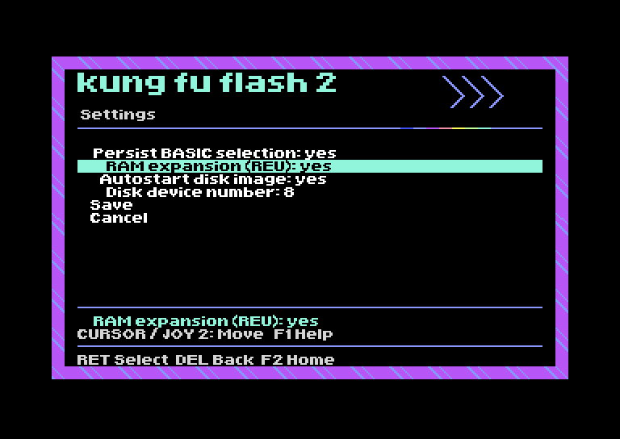
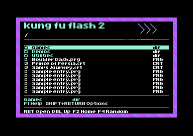

# KFF2 Graphical Menu

An experimental graphical home screen integrated with Kung Fu Flash 2's native
launcher, inspired by EasyFlash 3. The current firmware candidate is **v2.G7**.
G7 needs physical KFF2 testing. G5 Home and file-browser rendering have been
checked by the user on hardware.

## G7 additions

- Shift+Return file/folder options: **Copy to Favourites**, keeping originals.
- Settings: **REU size**, choosing 1 MB, 512 KB or 256 KB.
- Settings: **Autoboot last selection**, choosing whether startup returns to Home.

Based on upstream **v2.07 plus one documentation commit**, not an unrelated
community fork. Existing settings keep their defaults and configuration layout.
Read [operation, limits and test coverage](docs/g7-features.md).

## Shared appearance, G6

Settings, REU configuration, F3 cart utilities, file options, Help, search,
messages and the text reader now use the same frame and font as Home and Games.
Early startup diagnostics retain native text until graphics are available.
See [screens, checks and remaining hardware tests](docs/uniform-ui.md).

The firmware now uses Home's exact patterned border and masthead in the live
file browser, with twelve visible rows, file icons and cyan selection. The
original 23-entry paging and loading protocol is retained.

[Browser implementation and CRT checks](docs/browser.md) ·
[G5 hardware test notes](docs/g5-testing.md)

## Current milestone

**F4: Random game** picks a supported file from `/Games` and its subfolders,
avoiding the last 10 distinct games where possible. G3 adds persistent manual/
random launch counts. See [history and PC CSV export](docs/launch-history.md). See [behaviour and limits](docs/random-game.md).
G3 retains the disk-image/context fixes and makes Random disk autostart explicit,
even when ordinary image autostart is disabled.
Do not use the older G1 image for new testing.

**Games / Tools / Utilities / Favourites > styled file browser > Home** is
connected. F2 returns Home while preserving the folder and selected entry. B
opens Browse, S opens Settings, F3 opens built-in cart utilities and Q opens BASIC.
The browser uses the existing Home font, a patterned surround and a 12-row
viewport. F4 also runs Random directly from the browser.

The native C64 image remains 16 KB, with **630 bytes free** in its main ROM
allocation. The unused 16 KB flash region is not used. The full MCU update is
128 KB. No original cartridge features were intentionally removed, and the ARM
firmware adds folder dispatch, random selection, a persistent launch journal
and a graphics/font bank transferred to C64 graphics RAM as needed. Full compatibility needs hardware testing.

Existing autoload and direct PRG/USB, cartridge and disk boot paths remain;
the home screen appears when the native launcher enters menu mode.

## Try it in VICE

Autostart [kff2-integration-test.prg](preview/kff2-integration-test.prg) in x64sc.
This runs the patched native menu with a simulated cartridge data source:

- B on Home opens the directory. Cursor keys and Return select.
- F2 returns Home without clearing the folder or selection.
- G/T/U/F open the four simulated collections; S/F3 open Settings/cart utilities.
- F4 records a random-game request in the harness; it does not scan or load SD files.
- Q on Home exits the harness to BASIC.

Directory entries are test data. No SD files or games are loaded. This harness
does not emulate the cartridge's ARM hardware, disk drive, USB or REU.
The earlier [visual-only preview](preview/kff2-menu-preview.prg) remains available.

## Experimental firmware

The complete update, checksum and build report are under
[firmware/experimental](firmware/experimental/README.md). The software checks
verify layout and menu routing; they do not validate physical cartridge timing
or loading. This is an altered development build, not an official release.

## Build and test

Install cc65, GNU make, patch and Python 3. Generating artwork also needs Pillow and liblz4. Obtain the upstream KFF2 source at
commit `9c84d999f4e2f5b2c7688cbc37a127069f5401b0`, then:

    python3 tools/design_folder_home.py
python3 tools/pack_folder_home.py
python3 tools/build_integrated_launcher.py --upstream /path/to/KungFuFlash2

This builds the native launcher and interactive/automated VICE harnesses.
Run the VICE checks with your own C64 ROMs:

    python3 tools/test_integrated_launcher.py --vice /path/to/x64sc \
        --rom-dir /path/to/vice/C64

With a configured GNU Arm Embedded toolchain and newlib development files:

    python3 tools/test_uniform_ui.py --vice /path/to/x64sc --rom-dir /path/to/vice/C64

    python3 tools/build_firmware.py --upstream /path/to/KungFuFlash2

The packaging script checks that the software-test hashes match the launcher.
See [integration notes](experiments/home-integration/README.md) and
[firmware notes](firmware/experimental/README.md) for inputs, outputs and limits.

The older standalone UI can be built with `make -C launcher/preview`.
Regenerate the artwork using `python3 tools/make_kicker.py`.

## Size work

- The UI payload was reduced from 4,062 to **3,241 bytes**, with identical pixels
  and all font mappings retained. See [optimisation notes](docs/ui-size-reduction.md).
- Replacing general formatting and a single heap allocation saves **2,560 bytes**
  in the native launcher. See [optional patches](experiments/launcher-size/README.md).
- The initial [ROM investigation](docs/rom-space-investigation.md) also documents
  the separate-payload option if future growth makes it useful.

## Next

Read the [recovery guide](firmware/experimental/RECOVERY.md), then test G6's
Settings, options, search, warnings and reader on hardware. Confirm game loading,
REU and USB independently. Favourites remains a manually organised folder.

## Upstream and credits

This repository contains the UI, build tools and patches. Native builds use:

- [Kung Fu Flash 2](https://codeberg.org/KimJorgensen/KungFuFlash2),
  Kim Jørgensen, baseline `9c84d99` (one commit after v2.07).
- [EasyFlash 3 menu](https://github.com/easyflash-mirror/easyflash3-bootimage),
  Thomas Giesel, baseline `bf89562`, providing the proportional font and renderer.

Original notices are retained. See [LICENSE](LICENSE) and
[EF3-LICENSE.md](launcher/ui/EF3-LICENSE.md). No C64 ROMs or games are distributed.
