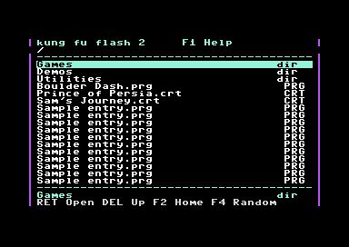
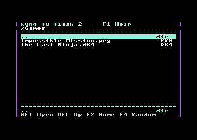

# G4 file browser and CRT readability

G4 replaces the ordinary file-list presentation with a compact character-mode
skin. This is implemented C64 output, not the earlier high-resolution concept.

The screenshot directory entries are simulated. Firmware reads the real SD card.

## Layout

- Standard C64 8x8 character cells, no smaller or thin custom font.
- White filenames and path on black, cyan selection with black lettering.
- Purple decorative edges and cyan separators.
- Header on row 1, path/search on row 2, 17 list rows at 4 through 20.
- Selected entry repeated on row 22, controls on row 23.
- Rows 0 and 24 contain no essential browser text; list columns 1 through 38
  leave one character at each side. This gives some overscan allowance,
  not a guarantee for every television.
- Three-letter SD extensions such as PRG, CRT, D64, D71, D81, P00 and UPD
  appear at right. Other SD names retain the size label. Filenames still include
  their extension. This changes presentation, not which files are supported.

The native 23-entry cartridge page packet is unchanged. A 17-row local viewport
scrolls within each packet. Cursor left/right still page, DEL or fire-left goes
up a folder. F2 returns Home. F4 uses the existing /Games random runner, including
history avoidance, from either Home or browser. F1 explains remaining shortcuts.
Settings/options keep their original 23-row layout so text and controls remain
available. Native image directories keep their original entry information.

## Scope and size

The prototype fits the same 16 KB C64 image, with 132 bytes spare in its main
ROM allocation. CODE no longer has an unnecessary 256-byte leading alignment;
all linked entry points are relocated by the linker. Startup, EAPI, Ultimax and
vector sections remain present. Help is compacted, retaining the original
commands, plus F4. The ARM image adds the extension formatter.

The concept's custom icons, full-path filename display, total-entry counter and
selected-game statistics line are not implemented. The selected detail line
repeats the existing bounded filename/type packet, not a full untruncated name.
G3's journal and PC report still work, with no extra SD reads when moving the
selection. Further decoration and statistics require more ROM/data-protocol work.

## Verification and CRT acceptance

VICE PAL tests cover Home transitions, settings/utilities, paging and option
selection. G4 checks screen/color RAM after viewport scrolling and verifies F4
from the Games browser. Home's graphics bank is still compared byte for byte.
An NTSC startup capture is also produced. Host and real-FatFs launch-history
checks pass. Native boot, cartridge bus timing and real video output remain
untested on physical KFF2 hardware.

A native VICE capture shows the actual font and layout. It does not prove
readability on a CRT. PAL/composite filtering can help preview blur, but the
physical acceptance check is still required:

1. On the intended C64 and CRT, check the long filenames and right-hand types
   at the usual viewing distance. Include the poorest connection you intend
   to use, especially composite or RF rather than only S-video.
2. Check the top path and bottom controls for cropping. Confirm the selected
   row remains obvious with the CRT's normal brightness and colour settings.
3. Scroll beyond entry 17 and across the 23-entry packet boundary. Check the
   last filename and footer for flicker, smearing or lost characters.

This candidate is experimental, not a hardware-tested release. G3 remains
available for rollback; see the recovery guide before installing custom firmware.
