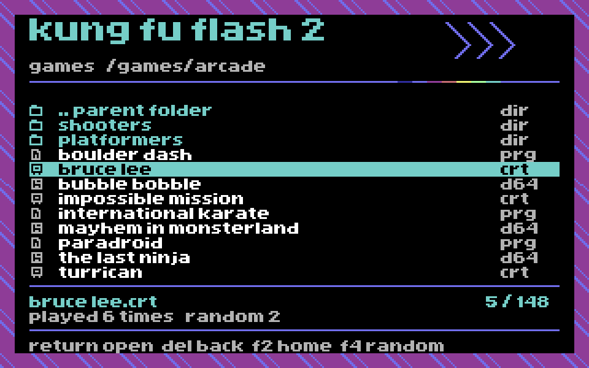

# Browser layout with the original Home border

This is a **static layout experiment**, not another firmware release. G4's
browser remains unchanged. The PRG displays sample filenames and counts and
returns to BASIC when Space is pressed. It does not browse or launch games.

The geometric surround is copied from the existing Home bitmap and palette,
including all four edges and corners. The generator checks every border cell
byte for byte. The Home title and chevron artwork are also preserved exactly.

The layout is native 320x200 hi-res bitmap mode, with twelve list entries,
8x8 pixel file icons, a cyan selection bar, a details band and a controls band.
It uses the existing licensed EF3 / Home proportional font. The 960x600 image
is an exact nearest-neighbour enlargement of the native pixel render.

The displayed launch counts and index are sample design data. They are not
new G4 features. Dynamic rendering, navigation and the extra history metadata
still need integrating and measuring against the firmware ROM budget.
No firmware-size claim is made for this independent PRG.

## Build and inspect

With cc65 on PATH, Pillow and the existing source assets:

    python3 tools/design_browser_border.py

Autostart [the layout PRG](../../preview/kff2-browser-border-preview.prg) in VICE.
Press Space to return to BASIC. The PRG loads at $0801 and enters through
BASIC SYS 2061. Screen matrix is $5c00-$5fe7, bitmap is $6000-$7f3f, both
in VIC bank $4000. The preview saves/restores the display, sprite enable,
CIA2 port/bank configuration and charset-toggle state. No custom IRQ or zero
page storage is installed.

To verify against VICE using your own C64 ROMs:

    python3 tools/test_browser_border.py --vice /path/to/x64sc --rom-dir /path/to/C64

The check compares the actual VIC bank with the generated matrix/bitmap, then
injects Space and checks the restored display registers. The raster-counter
bit of $d011 is excluded from that comparison. See measurements.json.

Physical CRT readability remains unverified. Check normal viewing distance,
composite/RF blur, the folder/file distinction, selection contrast, and whether
the first/last text bands are cropped. The border itself matches Home rather
than being an approximation of its artwork.
