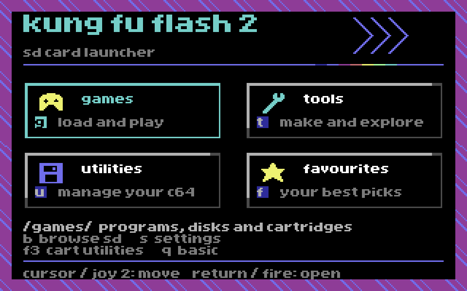

# Folder Home design preview

A proposed replacement for the large high-kick figure and vertical button list.
Four folder panels fill the main area, with the existing system actions below.

The revised design takes cues from EasyFlash 3's colourful framing and shaded
menu panels: a purple geometric surround, cyan selection edges, bevelled black
panels, coloured gamepad/wrench/disk/star icons, and a small spectrum accent.
The paths appear only in the context line. The surround and icons are new
artwork drawn for this project, not EasyFlash's original background bitmap.



This image is a pixel layout render of the exact C64 bitmap and colour matrix
used by the PRG. It is not a VICE screenshot. This design is **not in v2.G1**.

## Intended folder mapping

| Tile | SD card directory | Intended contents |
|---|---|---|
| Games | `/Games/` | PRGs, cartridge images and disk images |
| Tools | `/Tools/` | Editors, diagnostics and other programs |
| Utilities | `/Utilities/` | Your own utility collection |
| Favourites | `/Favourites/` | A collection you organise yourself |

These are proposed shortcuts to ordinary directories. Tools and Utilities are
separate collections for the user to organise, with no file-type restrictions.
Favourites initially means copies of files placed in that folder, not a database
or automatic list. Keep each multi-disk game together in its own subdirectory.

Built-in cartridge utilities stay separate, labelled **Cart utilities** on F3.
Browse SD (B), Settings (S) and BASIC (Q) remain visible at the bottom.
Missing-folder handling is still to be implemented; the proposed behaviour is a
clear message showing the expected path and an option to open Browse SD.

## Try the design

Load [kff2-folder-home-preview.prg](../../preview/kff2-folder-home-preview.prg)
in VICE as an ordinary C64 PRG. This is a separately compiled design prototype.
The four folder buttons and system buttons show confirmation screens, without
reading an SD card or loading programs. Q returns to BASIC.

- Cursor left/right switches column; up/down switches row.
- Joystick port 2 uses the same navigation. Return or fire opens the selection.
- G, T, U and F open their corresponding tile confirmation screens.
- B, S and F3 preview the other actions; Q exits.

## Build and verification

Requires cc65, make, Python 3 and Pillow for PNG export:

```sh
python3 tools/design_folder_home.py
make -C experiments/folder-home check
```

The generator reads the existing EF3 proportional font, approved title and
`design.json`. It produces the C64 bitmap streams, matrix, four descriptions
and all four PNG previews. Every RLE stream is checked against its original
bytes. Coordinates are checked against the 320x200 bitmap bounds.

The PRG compiles with cc65 2.19. Its load address, BASIC SYS entry, linked memory
range and decompressed stream lengths are checked. It has **not been run in
VICE or tested on hardware in this iteration**. Keyboard and joystick handlers
are included, but their operation is not yet verified in an emulator.

The bitmap lives at `$6000-$7f3f`, its matrix at `$5c00-$5fe7`. Program, assets
and C stack remain below `$4000`. Original video-register values are restored
on leaving the graphical screen.

This prototype uses a complete compressed static bitmap so the PNGs and PRG
share the exact layout. Its asset size is recorded in `measurements.json`.
That is **not a native firmware ROM-fit measurement**. Connecting real folder
navigation and fitting the design into the native launcher are the next steps.

Font: Thomas Giesel / EasyFlash 3. Existing copyright and licence remain in
`launcher/ui/charset.sed` and `launcher/ui/EF3-LICENSE.md`.
