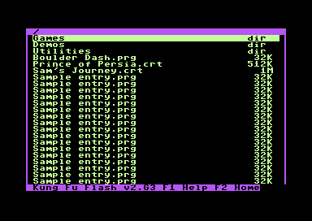

# Home-screen integration, experimental v2.G3

The graphical home now dispatches into the original compact launcher.
The native C64 launcher links into the original 16 KB image, with 129 bytes
free in its main 14 KB allocation. The complete MCU update is also built;
see [firmware/experimental](../../firmware/experimental/README.md).

This milestone implements **Home > existing text browser > Home**. It does
not replace the browser's list renderer with a graphical one yet.

G3 adds the ARM-side launch journal and recent-game avoidance. See
[history behaviour and tests](../../docs/launch-history.md). The C64 UI is unchanged.

## Native changes

Apply `compact-launcher.patch` from the size experiment, then `home-menu.patch`.
Then apply `folder-home.patch` to add the four collection replies and shared
command index. The Home UI includes its generated LZ4 bitmap and assembly decoder. F2 returns to the home screen. Returning to Browse redraws the
cached directory rather than reloading it or clearing its selection.

The home screen opens when the launcher enters menu mode. Existing direct
PRG/USB, disk and cartridge boot paths are left intact, including autoload.
F1 help gains the F2 shortcut. Existing browser search, paging, selection,
Shift+Return options and other function-key routes are retained.

Native disk, USB, EAPI and startup assembly are copied from upstream without
source changes. The allocator and formatter patches remain the only other
changes to the original launcher C source. The ARM Home/random modules are included by `folder-arm.patch`; original storage/emulation code is retained.

## Try the VICE harness

Autostart [kff2-integration-test.prg](../../preview/kff2-integration-test.prg)
in VICE's C64 emulator.

- B on Home opens the simulated directory.
- Cursor keys and Return use the original launcher menu code.
- F2 returns Home, preserving the directory and selection.
- G/T/U/F open the four simulated collections; S/F3 open Settings/cart utilities.
- F4 records the random-game request, stopping before any real loader.
- Q on Home exits the harness to BASIC.

The entries are built-in test data, not files on an SD card. Selecting a program
records the selection byte and displays a notice; it does not execute a game.
The S/F3 lists are stand-ins, not complete implementations of cartridge settings
or utilities. Search input is retained, but the simulated server does not filter.
The original Run/Stop reset route is retained; use F2 to return Home.

The harness compiles the actual patched `menuLoop` and `dir.c` with the shared
home renderer. It bypasses the initial hardware-ID check and substitutes the
cartridge's command/data interface. Automated copies additionally substitute
scripted input. A separate check drives the interactive build using C64 keyboard
buffer bytes, so its ordinary `kbhit`/`cgetc` path is exercised too.

## Build

Requires Python 3, Pillow, liblz4, cc65, make, patch and an upstream KFF2 checkout at
`9c84d999f4e2f5b2c7688cbc37a127069f5401b0`.

    python3 tools/design_folder_home.py
    python3 tools/pack_folder_home.py
    python3 tools/build_integrated_launcher.py --upstream /path/to/KungFuFlash2

An unpacked cc65 build can be selected using `--cc65-home /path/to/cc65`.
The default identifier is v2.G3, which fits the original 20-byte version field.

Outputs under ignored `launcher/build/integration/`:

- `native/kff2-integrated-launcher.bin`: C64 launcher only, not an MCU update.
- `interactive/kff2-integration-test.prg`: interactive simulated-cartridge harness.
- `scenario-1` through `scenario-5`: automated harness variants.
- `source/launcher/main.c`: patched native source for inspection.
- `native-measurements.json`: native ROM/RAM measurements.

## Run the checks

With VICE x64sc and legally obtained C64 ROMs:

    python3 tools/test_integrated_launcher.py --vice /path/to/x64sc \
        --rom-dir /path/to/vice/C64

The script expects `kernal-901227-03.bin`, `basic-901226-01.bin` and
`chargen-901225-01.bin` in that directory. No ROMs are distributed here.

Verified in VICE 3.7.1:

1. Enter Games, move selection, Home/Browse return with folder and selection
   intact, then Settings, Utilities and BASIC. Exact reply sequence checked.
2. Select item 3 using Shift+Return: selection byte `$43` retains the options flag.
3. Cross the 23-entry page boundary, return to the previous page, visit Home,
   and select item 22: page replies and selection byte `$16` checked.
4. Open all four named collections and use right/down/Return to select Favourites.
   Exact folder reply sequence and all four indexes checked.
5. Use B, F2, B, F2, Q through the C64 keyboard buffer in the interactive build.
   No extra directory reload occurs during the Home/Browse returns.
6. F4 sends the random-game reply and C128 flag without entering a loader.
7. NTSC startup screenshot inspected. The full navigation scenarios ran as PAL.

The first full VIC bank is dumped from VICE and compared byte for byte with the
generated design, including the active matrix and selected description. The native
UI reserves `$4000-$7fff` while visible. The PRG harness relocates mock BSS to
`$8000-$8fff` and its C stack below `$c000`, keeping both out of that bank.

Test status is read from emulated RAM at the completion checkpoint. Old status
files are removed before running, and successful traces are checked independently
in Python. The results include hashes tying the native ROM and interactive PRG
to that build. See [test-results.json](test-results.json).

## Remaining work

The native ROM's reset/boot path and ARM cartridge timing have not run in VICE.
The harness does not emulate real SD, USB, disk drive, CRT or REU operation.
Those need physical KFF2 tests. C128 mode and a physical joystick are untested.

The browser is still text-based. Replacing its renderer is the next visual step.
Its 23-row page protocol needs a viewport if the graphical list displays fewer
rows. Any change must preserve selected entry indexes and existing menu replies.

The spare 16 KB flash region is not used by this build. The single-bank route
now includes the home dispatch and fits, although its 129-byte margin is small.
