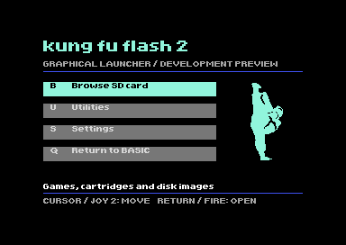
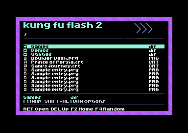

# Experimental firmware v2.G5, Home-bordered bitmap browser

[KungFuFlash_v2.G5.upd](KungFuFlash_v2.G5.upd) is a complete 128 KB KFF2 update
with the revised graphical Games, Tools, Utilities and Favourites screen.
Use G5 for new testing. The retained G1 image has known disk-image-exit and
cart-utilities context bugs, fixed in G2. This is **not an official release and has not been tested
on physical KFF2 hardware**.



## G5 browser



The live file browser now keeps Home's exact patterned surround, title and
chevrons. Twelve rows, file icons, cyan selection and the existing Home font
replace G4's text reskin. Disk/tape row information, including *PRG< flags,
is preserved. Settings, options and warnings keep their native text screens.

The ARM firmware supplies the graphics/font bank through a new menu reply.
C64 cursor movement renders locally. No SD graphics files are required.
The launcher still fits its 16 KB image, with **1,440 bytes spare**.

The static concept's example launch counts and total-file counter are not
present. G3 history logging and the PC report remain available. The details
band shows the selected bounded filename/type, with Help/options hints below.

Read [G5 test notes](../../docs/g5-testing.md) and
[browser implementation/CRT limits](../../docs/browser.md). It has **not been
checked on a physical CRT or KFF2**.

## Install and recover

Read [RECOVERY.md](RECOVERY.md) before flashing. A working launcher can load an
official update from SD. If the launcher fails, upstream documents USB DFU using
BOOT0/+3.3V on J1, or an ST-Link programmer. Those methods require board access.

Use a FAT32 card with `/Games`, `/Tools`, `/Utilities` and `/Favourites` folders.
Their names match the four buttons. Tools and Utilities are normal directories,
with no content restrictions. Favourites is a folder you organise yourself,
not a shortcut database. Keep multi-disk games together in their own directory.

Missing folders produce a message showing the expected path. OK opens SD root.
B opens the regular SD browser; S opens Settings; F3 opens built-in cart utilities;
Q starts BASIC. F2 in the file browser returns Home. Browse preserves its cached
folder/selection; opening a named collection switches to that folder.

## Launch history

G3 creates `/.KFF2-history` automatically, recording full paths, launch counts,
random-runner counts and last-launch order. F4 avoids the last 10 distinct Games
paths when alternatives exist; small libraries fall back to the least recent.
Manual Games launches also update that window. Files outside Games can have
statistics without displacing recent games.

Writes occur after loader preparation and before C64 handoff. Automatic boots,
mount-only operations and browsing do not count. This is a launch counter, not
a play-time measurement. Journal failures are best effort and do not deliberately
block a prepared launch. See [history rules, safety limits and CSV export](../../docs/launch-history.md).

## Random game

**F4 on Home or in the browser** scans `/Games` and its subfolders and starts a randomly selected
CRT, PRG, P00, supported disk image or T64. Updates/text/hidden files are excluded.
Random disk images autostart regardless of the normal autostart preference. Selection is per file, so duplicates, auxiliary programs
and secondary disks can also be picked. Missing or empty collections show a
message. See [selection rules and limits](../../docs/random-game.md).

G3 closes active disk/tape images when switching Home context and fixes F3 cart
utilities from Settings/options. Its dedicated Home replies leave normal browser
shortcuts intact. It reclaims unneeded RODATA page-alignment padding; CODE's
original page alignment and the image layout below are retained.

## Changes and checks

The native C64 launcher remains 16 KB with **129 bytes free** in its 14 KB main
ROM allocation. The graphics are stored as a 2,648-byte raw LZ4 block and decoded
into the scratch VIC bank at `$4000-$7fff` while the screen is blank. Its stored
font and graphics pixels are unchanged from the approved design.

The ARM source includes Home dispatch, random selection and launch-history modules. It validates the
four-entry index, clears search for folder switches, handles missing folders,
and retains the original unsaved EasyFlash CRT prompt before changing folders.
The original disk, USB, cartridge emulation, REU and boot implementations are
retained. Hardware compatibility across them remains unverified.

Verified:

- VICE navigation, all four folder requests, cursor-based selection and F4 dispatch.
- Original paging and Shift+Return selection flag behaviour.
- Native Settings/utilities routes and interactive keyboard Home/Browse/BASIC routes.
- Decompressed graphics bank matches the generated design byte for byte.
- Host tests of the exact ARM dispatcher: four paths, invalid index,
  10,000 selection seeds, hidden/non-game filtering, scan-error cleanup, launch
  routes, image/options context transitions and preservation of unsaved CRT changes.
- Journal count/origin persistence, recent avoidance, loader hook ordering and failure cases.
- Actual FatFs on a RAM FAT32 disk: append/sync/remount, tail repair and read-only handling.
- Independent PC report decoding and CSV export support.
- Full update size, version, reset/stack vectors, blank padding, embedded launcher
  hash and SHA-256 checksum.

The harness uses simulated directory data. It does not emulate the STM32 or
verify real SD/CRT loading, bus timing, USB, REU, C128 or a physical joystick.

## Image layout

| Region | File offsets | Size |
| --- | --- | ---: |
| ARM firmware allocation | `$00000-$17FFF` | 96 KB |
| Preserved blank padding | `$18000-$1BFFF` | 16 KB |
| Modified C64 launcher | `$1C000-$1FFFF` | 16 KB |

The `.upd` is exactly 131,072 bytes. Older G1/G2 images are retained as history;
the current report describes G3. See [build-report.json](build-report.json)
and [SHA256SUMS](SHA256SUMS) for the build identity. GCC's warnings about upstream's
ITCM vector table at address zero are preserved, not suppressed.

## Reproduce

Requires Python 3, Pillow, liblz4, cc65, make, patch, host GCC for dispatcher
checks, VICE/C64 ROMs for launcher tests, and GNU Arm Embedded GCC/binutils/newlib.

```sh
python3 tools/design_folder_home.py
python3 tools/pack_folder_home.py
python3 tools/build_integrated_launcher.py --upstream /path/to/KungFuFlash2
python3 tools/test_integrated_launcher.py --vice /path/to/x64sc --rom-dir /path/to/C64
python3 tools/build_firmware.py --upstream /path/to/KungFuFlash2
```

The upstream baseline and compiler versions are recorded in the build report.
Unpacked toolchains can use `--arm-bin`, `--newlib-include` and `--newlib-libdir`.
No files in the upstream checkout are edited. The browser itself still uses its
original text renderer. Physical KFF2 validation is the next step.
